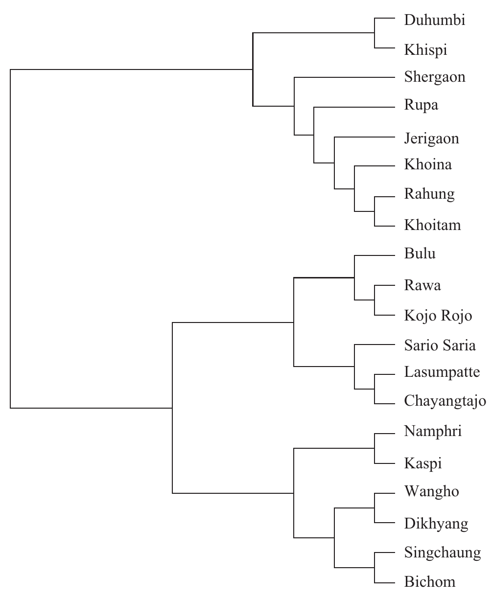
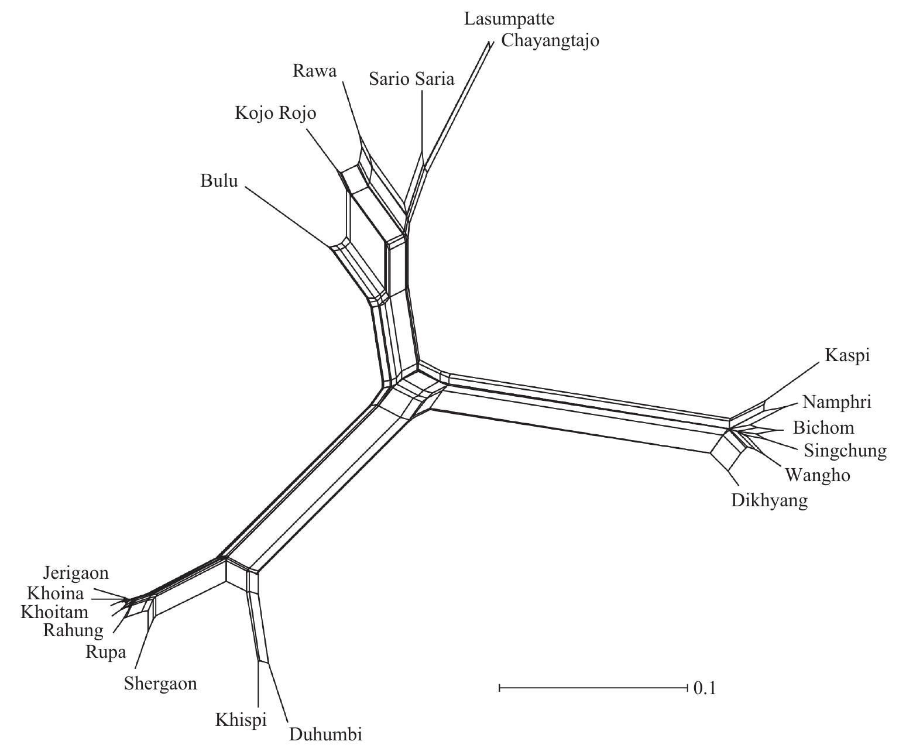
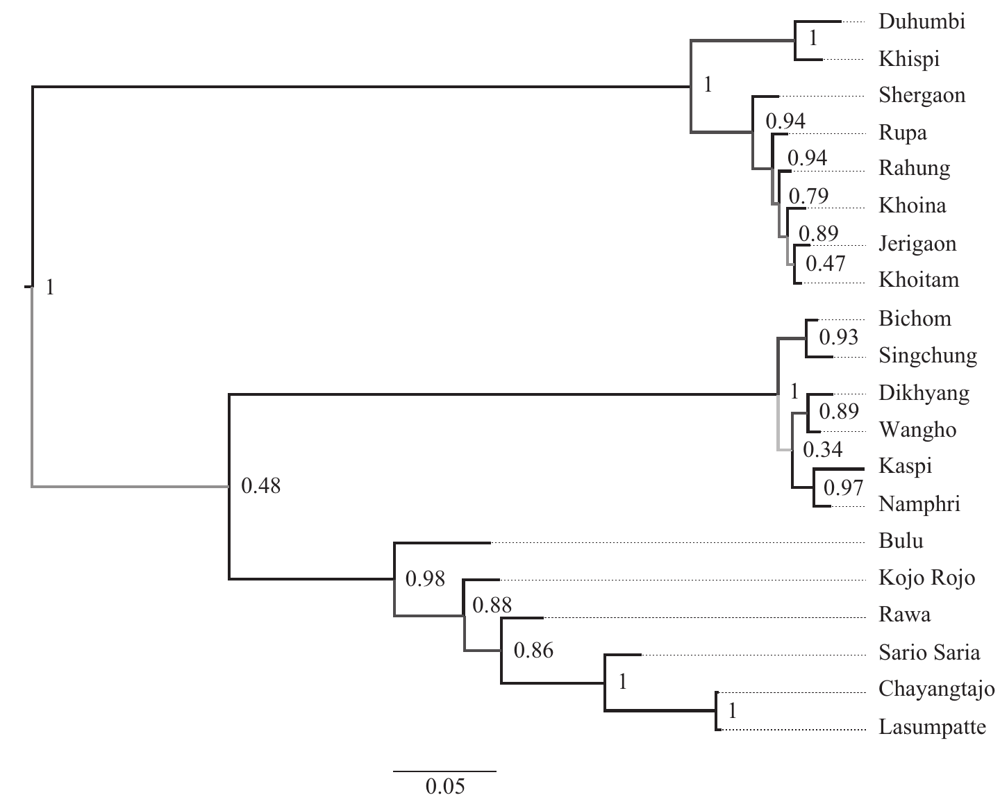
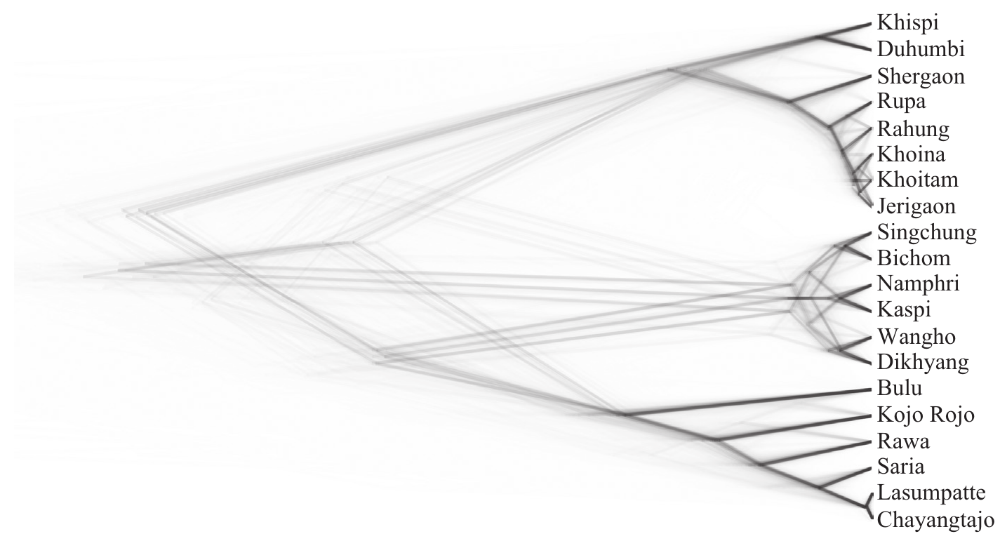

# [숙제08] 언어데이터 관리 사례 발표

## 28 Managing Historical Linguistic Data for Computational Phylogenetics and Computer-Assisted Language Comparison

+ Class: Linguistics and Data Science
+ Presenter: 최혁재
+ Date: 2026-10-24

### Table of content

1. Introduction
2. Data collection (stage 1)
3. Cognate identification (stage 2)
4. Exploratory data analysis (stage 3)
5. Phylogenetic analysis (stage 4)
6. Data sharing and deployment (stage 5)

### Section 1. Introduction

#### Computational phylogenetics

A relatively recent branch of historical linguistics that uses quantitative techniques to investigate the history of related languages.

+ It complements traditional techniques for sub-grouping based on shared innovations (the classical comparative method).
+ Linguistic data compiled for other purposes are hard to adapt, so there are increasing attempts to prepare the original data in ways amenable to qualitative inspection and quantitative investigations.

#### Problem

Data preparation has not been standardized so far.

+ Scholars use a variety of custom formats, from inadequate coding (links to the original sources lost) to complex formats readable only by specific, sometimes unavailable, programs.
+ As a result, it is difficult for newcomers to find good instructions on data handling and conversion.
+ Additionally, data reuse is hampered, because information on sources, languages, and questionnaires is usually not supplied in a standardized form.

#### Goal: "FAIR" data

Ideally, all linguistic data should be **FAIR** (Wilkinson et al. 2016):

+ **F**indable, **A**ccessible, **I**nteroperable, and **R**eusable.
+ FAIR applies not only to the final product but to all intermediate stages of preparing, curating, and transforming the data.

The chapter shows, with a concrete workflow,

1. how to collect and store crosslinguistic information,
2. how to guarantee that data sets are crosslinguistically comparable,
3. how to store intermediate and final results of the analyses, and
4. how to share data in a reusable form.

#### Data

The data set of Lieberherr and Bodt (2017), which the authors made publicly available

+ Lexical entries for a hundred concepts, derived from the concept lists of Haspelmath and Tadmor (2009) and Swadesh (1971)
+ Translated into twenty-two "highly divergent, endangered, and poorly described" languages of the Kho-Bwa sub-group of the Sino-Tibetan language family (twenty varieties selected)
+ The unit of analysis is the **cognate set**: a set of related words in different languages that go back to a common ancestor word, identified by the comparative method or computer-assisted approaches.

#### Phylogenetic data life cycle

1. Data collection: converting sources into a machine-readable word list.
2. Cognate identification: adding cognate judgments to the word list.
3. Exploratory data analysis: visualizing the signal in the data.
4. Phylogenetic analysis: e.g., Bayesian models giving a dated and rooted tree.
5. Data sharing and deployment: publishing the data in a FAIR form.

### Section 2. Data collection (stage 1)

#### General remarks on data management

The data model that many linguists still use was popularized by **Morris Swadesh**.

+ A list of non-cultural concepts is translated into the target languages.
+ Result: a simple table where **rows = concepts** and **columns = languages**, as in Table 28.1.
+ Simple, easy to inspect and produce, and editable with any spreadsheet software.

##### Table 28.1

Sample word list from the Kho-Bwa data set in the traditional word list form

|Concept|Dikhyang|Wangho|Rawa|
|-|-|-|-|
|"Big"|əpõː|ebou|arai|
|"Bird"|fuə|fua|pədoː|
|"Blood"|əfuɛ|efua|fui|

#### Limitations of the traditional table

The simplicity is only apparent and restricted to lexicographic entries, creating complications once scholars include other information besides the translations.

+ What should one do if unable to decide for one of several alternatives to translate a concept?
  + List synonyms in one cell separated by a comma, slash, dash, or `|`?
  + Pick the most common form (Swadesh), or "flip a coin" (Gudschinsky)?
+ No consensus on how to annotate cognacy. The usual solution is an extra "Cog" column next to each language, as in Table 28.2.

##### Table 28.2

Cognate judgments added in extra columns labeled "Cog"

|Concept|Dikhyang|Cog|Wangho|Cog|Rawa|Cog|
|-|-|-|-|-|-|-|
|"Big"|əpõː|1|ebou|1|arai|2|
|"Bird"|fuə|3|fua|4|pədoː|4|
|"Blood"|əfuɛ|5|efua|5|fui|5|

#### A better strategy: the long table

Follow the insights of **relational databases** (Codd 1970) and adopt a **long-table format**: each cell containing a word form gets its own row.

##### Table 28.3

The same word list in long form

|ID|Language|Concept|Entry|Cogset|
|-|-|-|-|-|
|1|Dikhyang|BIG|əpõː|BIG-1|
|2|Wangho|BIG|ebou|BIG-1|
|3|Rawa|BIG|arai|BIG-2|
|4|Dikhyang|BIRD|fuə|BIRD-1|
|5|Wangho|BIRD|fua|BIRD-1|
|6|Rawa|BIRD|pədoː|BIRD-2|
|7|Dikhyang|BLOOD|əfuɛ|BLOOD-1|
|8|Wangho|BLOOD|efua|BLOOD-1|
|9|Rawa|BLOOD|fui|BLOOD-1|

+ **ID**: a (numerical) identifier for each word.
+ The other columns describe aspects of the word: language, concept, form, cognate set.
+ It may look redundant, but this format has many advantages:
  + Synonyms are displayed without splitting a cell (just add an extra row for the concept).
  + Cognates are easy to annotate, and arbitrary information can be appended by adding a new column.

#### The Cross-Linguistic Data Formats (CLDF) initiative

To increase comparability and FAIRness, use additional tables that link the data to **reference catalogs**, which facilitate data set aggregation.

+ **Glottolog**: link each language variety to its Glottolog code (gives, e.g., geographic locations).
+ **Concepticon**: identifiers for standardized concept sets (gives, e.g., semantic categories, word frequencies).
+ **Cross-Linguistic Transcription Systems (CLTS)**: specifies which speech sounds are represented by which symbols, making transcriptions interoperable.

**CLDF** (https://cldf.clld.org) offers standard formats for different data types in historical linguistics and linguistic typology: word lists, structural data, dictionaries, and parallel texts.

+ Can be edited with normal spreadsheet editors, and offers tools to convert and validate data.
+ Supported by BEASTling and LingPy, with libraries for Python (pycldf) and R (rcldf); CLDFBench automates the creation of CLDF data sets.
+ Given its growing importance for data storing, sharing, and aggregation, the authors recommend coding phylogenetic data in CLDF.

##### Final product

A CLDF data set, created and loaded with LingPy (Lieberherr and Bodt 2019 is the CLDF version of the original data).

### Section 3. Cognate identification (stage 2)

#### Task

Annotating which words in different languages are etymologically related (cognates).

+ Information is sometimes available in etymological dictionaries or lexicostatistic data sets, but annotation is tedious with the "classical" table of Table 28.1.
+ Without enough historical information, scholars apply the comparative method to infer regular sound correspondences.
+ Computer-assisted framework: software preprocesses the data (automated alignment and cognate detection), then experts thoroughly review and correct it.
+ Use interfaces designed for the purpose (e.g., EDICTOR) to avoid errors with large data sets.

### Section 4. Exploratory data analysis (stage 3)

#### Distances between languages

Data prepared in CLDF are easily amenable to a range of phylogenetic analyses.

+ First, it is easy to extract distances, assuming that the more similar languages are, the more related they are (the assumption of lexicostatistics).

##### Table 28.4

Similarity matrix of a subset of Kho-Bwa languages (closer to 0.0 = more similar, closer to 1.0 = more dissimilar)

| |Dikhyang|Wangho|Rawa|
|-|-|-|-|
|Dikhyang|0.00|0.07|0.54|
|Wangho|0.07|0.00|0.52|
|Rawa|0.54|0.52|0.00|

#### From distances to trees and networks

Similarity matrices can be converted without effort to a tree using algorithms such as UPGMA (Unweighted Pair Group Method with Arithmetic Mean) or Neighbor-Joining, which mimic lexicostatistics.

##### Figure 28.1

UPGMA tree mimicking lexicostatistics.

A **Neighbor-Net** network (built in SplitsTree, to which CLDF data can be easily converted) constructs branches proportional to the amount of change between languages, and represents conflicting signals (e.g., borrowing, dialect chains) by box-like structures.

##### Figure 28.2

Neighbor-Net network visualization.

### Section 5. Phylogenetic analysis (stage 4)

#### Bayesian phylogenetic methods

Currently, the most powerful phylogenetic approach.

+ Builds trees in a way that mimics the comparative method, identifying where cognate sets are innovated and retained.
+ Models uncertainty and error in the estimated phylogenies, so that we can measure support for different sub-grouping hypotheses.
+ Packages such as BEAST need data in the **NEXUS** format, which can be generated from CLDF data with LingPy.

The Kho-Bwa data were analyzed with BEAST2 (binary covarion model, relaxed-clock model).

##### Figure 28.3

Maximum clade credibility tree from the Bayesian analysis (numbers = posterior support).

##### Figure 28.4

DensiTree showing the consensus trees from the Bayesian analysis.

#### Results

All three methods show strong similarities in their overall sub-grouping and are consistent with Lieberherr and Bodt (2017). All split the family into three major branches:

1. Western Kho-Bwa: Duhumbi, Khispi, Shergaon, Rupa, Jerigaon, Khoina, Rahung, Khoitam
2. Bugun: Bichom, Singchung, Dikhyang, Wangho, Kaspi, Namphri
3. Puroik: Bulu, Rawa, Kojo Rojo, Sario Saria, Lasumpatte, Chayangtajo

Notable differences are reported to the experts for investigation.

#### Why data management matters here

Because the data were published as a long-form table and converted to CLDF with ease, different methods could be applied to support or disprove the original hypotheses, saving preparation time and making it easy for anyone to reuse or combine the data.

### Section 6. Data sharing and deployment (stage 5)

#### Task

Sharing, creating, and maintaining reusable data in linguistics.

+ The modular architecture of CLDF lets researchers combine what fits their own pipelines; it enforces no theoretical constraints but makes data and results findable and accessible after the project ends.
+ Plain data sets can be shared on platforms such as **GitHub** and **Zenodo**.
+ The **Cross-Linguistic Linked Data (CLLD)** project deploys data as browsable web applications (e.g., WALS, WOLD, CLICS).
+ The supplementary tutorial, data, and code are archived at https://doi.org/10.5281/zenodo.4311308.

---

### Quiz question

What standardized format is used to store and share cross-linguistic datasets like wordlists and cognate sets, and can be read directly by tools such as LingPy for automatic cognate detection?

---
#### 생성형AI

- https://claude.ai/share/1aed3d14-8c35-4bba-b07a-016716898dae